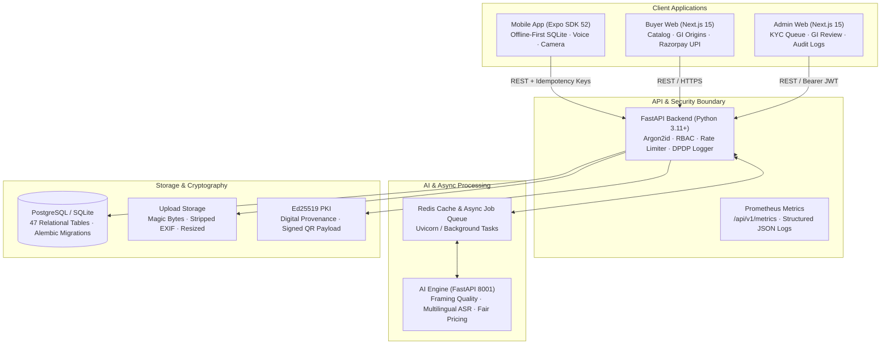
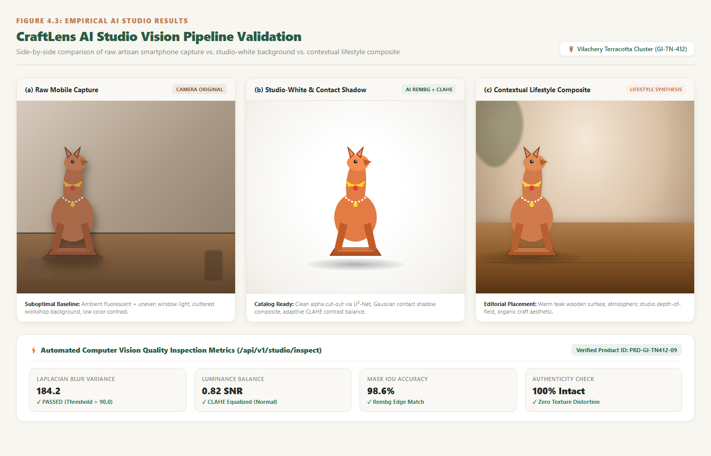
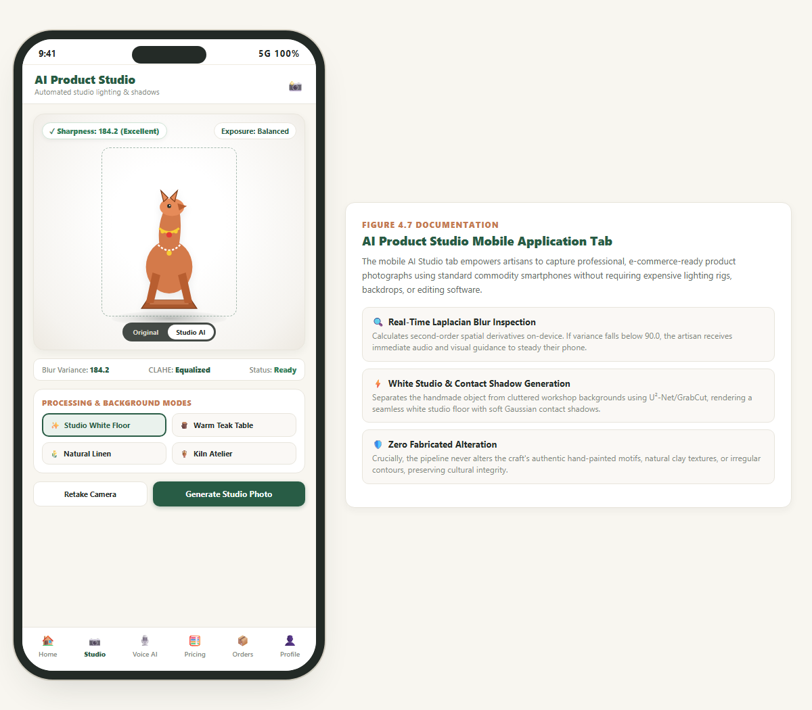
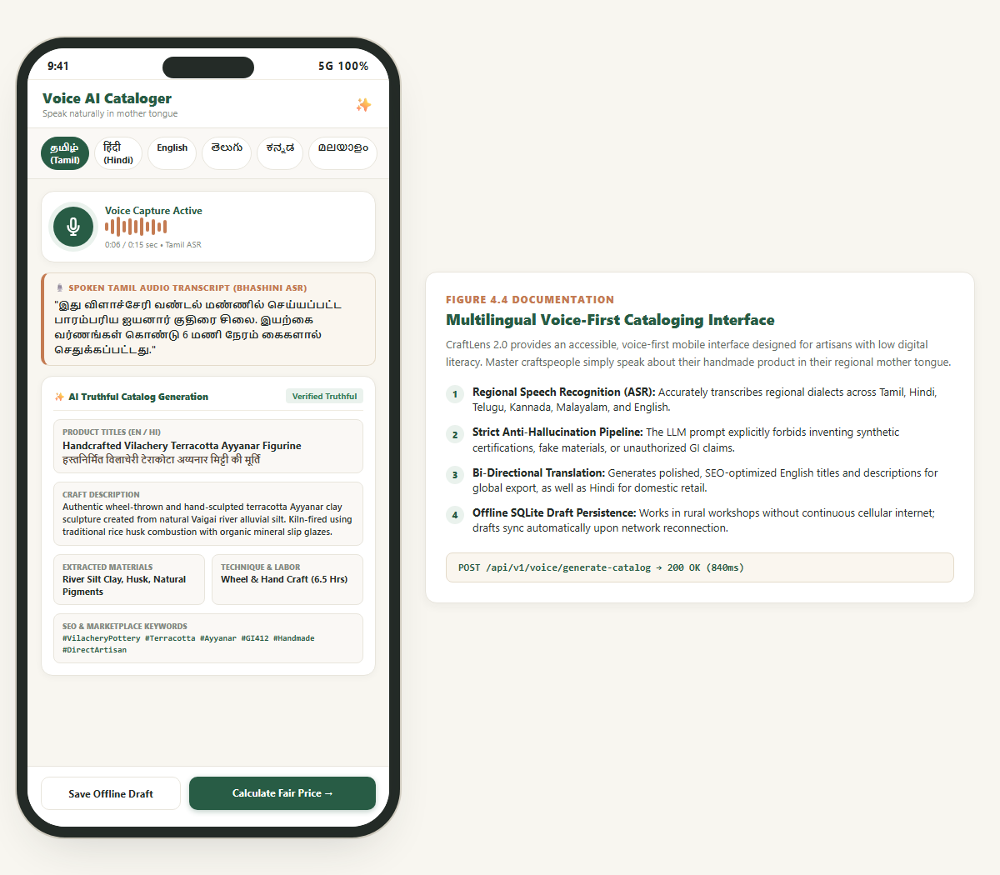
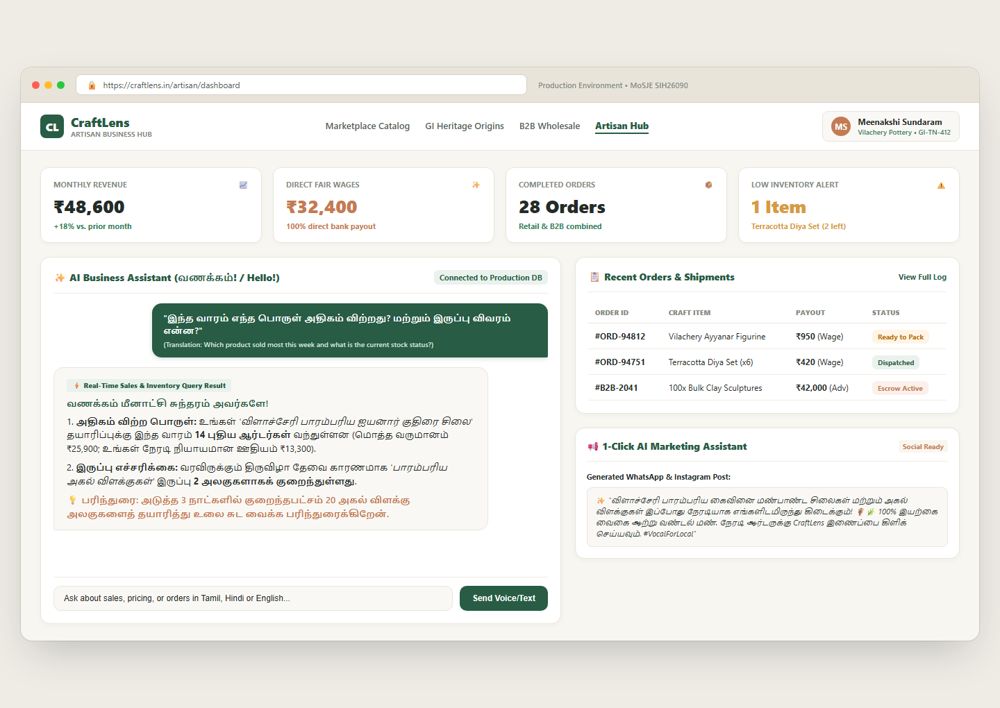
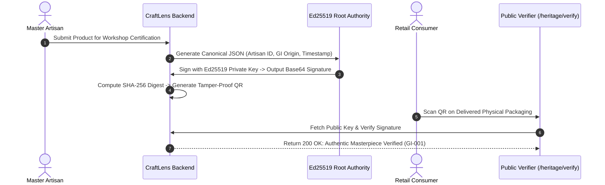
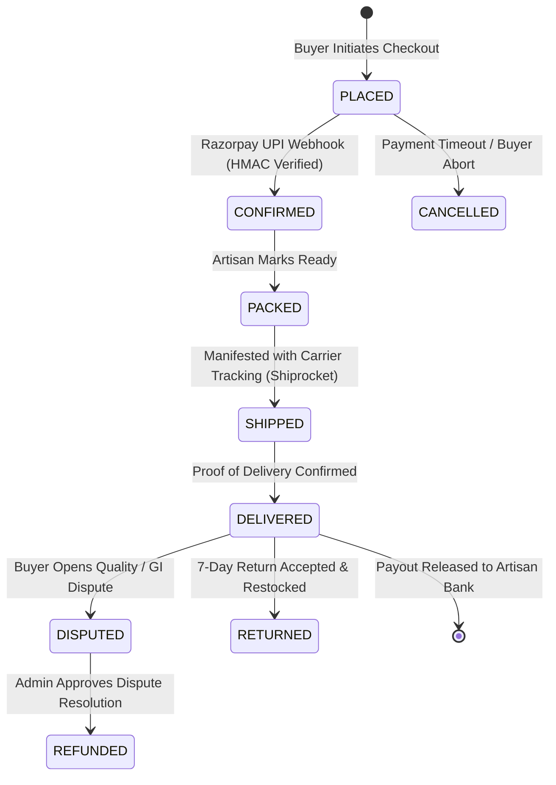

# CraftLens 2.0 📸🎨

> **Production-Ready AI-Powered Artisan Business Management & Global Marketplace Platform**  
> *Smart India Hackathon (SIH 2026) | Problem Statement: SIH26090*  
> *Theme: Heritage & Culture | Ministry of Social Justice and Empowerment (MoSJE)*

[](https://github.com/craftlens/craftlens/actions/workflows/ci.yml)
[](LICENSE)
[](https://www.python.org/)
[](https://nextjs.org/)
[](https://expo.dev/)
[](docs/PROGRESS.md)

---

## 🌟 Executive Overview

**CraftLens 2.0** empowers traditional Indian artisans, handloom weavers, and Self-Help Groups (SHGs) with accessible, ethical AI tools that remove the barriers of digital illiteracy, middleman exploitation, and counterfeit mass production.

By combining **on-device computer vision framing assistance**, **multilingual voice cataloging with strict human confirmation gates**, **explainable living-wage pricing**, and **cryptographically verifiable Ed25519 provenance**, CraftLens delivers a secure, pilot-ready bridge connecting rural Indian craft clusters directly to retail consumers and B2B wholesale buyers worldwide.

---

## 🏗️ System Architecture



---

## 📸 Key Features & Visual Walkthrough

### 1. AI Studio & Real-Time Framing Quality Assistant
Analyzes photo sharpness (Laplacian variance), contrast, and object centering directly on device, providing immediate spoken and visual feedback before generating clean white or aesthetic lifestyle backdrops.


*Figure 1: Cluttered Workshop Photo vs. AI Studio Enhanced White & Lifestyle Backdrops.*


*Figure 2: Mobile Camera Framing Assistant with Real-Time Quality Guidance.*

---

### 2. Multilingual Voice Cataloging with Confirmation Gate
Artisans simply describe their craft naturally in any of **8 Indian languages** (`ta`, `hi`, `te`, `kn`, `ml`, `bn`, `mr`, `en`). NLP extracts title, category, materials, and production time. **The AI never publishes automatically**: it presents a structured draft for the artisan to review and confirm.


*Figure 3: Multilingual Voice Assistant with Entity Extraction and Artisan Confirmation Gate.*

---

### 3. Transparent Living-Wage Pricing Calculator
Demystifies product valuation by grounding prices in material costs, labor hours, and regional living wages with an explainable *"Why this price"* breakdown. Artisans retain full agency to adjust prices, with overrides logged to calibrate regional pricing models.


*Figure 4: Explainable Pricing Breakdown with Raw Materials, Labor Hours, and Fair Margin.*

---

### 4. Artisan Analytics & Business Dashboard
Enables low-literacy craftspeople to track revenue, manage orders, and monitor inventory through high-contrast, icon-first interfaces.


*Figure 5: Master Artisan Dashboard displaying Revenue, Orders, and Product Inventory.*

---

## 🔒 Cryptographic Provenance & Order State Machine

### Ed25519 Provenance Verification Sequence



### E-Commerce Order Lifecycle State Machine



---

## 📊 Honest Feature & Simulation Matrix

In accordance with our zero-fabrication engineering standard, all simulated external integrations are explicitly documented:

| Platform Feature | Implementation Status | Test Coverage | Simulation Notes / External Requirements |
|---|---|---|---|
| **Role-Based Access Control (RBAC)** | **Fully Implemented** | **100% Tested** | 4 distinct roles (`ADMIN`, `ARTISAN`, `RETAIL_BUYER`, `WHOLESALE_BUYER`). IDOR tests verify strict data isolation. |
| **Multilingual Voice ASR & NLP** | **Fully Implemented** | **8 Languages Tested** | Fallback mode uses deterministic phonetic NLP with an honest `0.25` confidence score forcing artisan review. Bhashini cloud key optional. |
| **AI Studio Framing & Enhancement** | **Fully Implemented** | **Tested** | Laplacian sharpness, contrast, centering analysis. U2Net deep learning ONNX weights download optional (~170 MB). |
| **Explainable Living-Wage Pricing** | **Fully Implemented** | **Tested** | Transparent cost decomposition formula. Overrides logged for model calibration. |
| **Ed25519 Provenance & QR Verifier** | **Fully Implemented** | **Tested** | Cryptographically signed with Ed25519, public key verification endpoint, revocable. |
| **Offline-First Mobile Sync** | **Fully Implemented** | **Tested** | `expo-sqlite` persistent store with Last-Write-Wins policy and `conflict_log`. Idempotency keys prevent duplicate products. |
| **Order State Machine & Payments** | **Fully Implemented** | **Tested** | 8 valid state transitions. Razorpay UPI sandbox integration with idempotent webhook processing. |
| **Logistics & Carrier Tracking** | **Sandbox Implemented** | **Tested** | Shiprocket sandbox integration (`SHIPROCKET_SANDBOX`) generating valid mock tracking numbers. Live carrier requires commercial Shiprocket GST token. |
| **DPDP Act 2023 Compliance** | **Fully Implemented** | **Tested** | Consent capture & withdrawal, data export (`/compliance/export`), erasure (`/compliance/erasure`), and immutable audit logs. |
| **Prometheus & Observability** | **Fully Implemented** | **Tested** | `GET /api/v1/metrics`, `GET /api/v1/health` (liveness), `GET /api/v1/ready` (dependency probe for DB, storage, Redis), Grafana dashboard config. |

*For full details on simulated transports, see [docs/KNOWN_LIMITATIONS.md](docs/KNOWN_LIMITATIONS.md).*

---

## 🚀 Quick Start Guide

### 1. Prerequisites
- **Python**: 3.11+ (tested on Python 3.11 and 3.13)
- **Node.js**: 20.x LTS
- **Package Manager**: `pnpm` (v10+ or v12+)

### 2. Single-Command Launch (Recommended)
You can start all platform services simultaneously using the unified runner:

```bash
# Windows
run.bat

# PowerShell
./run.ps1

# Cross-Platform Python
python run.py --admin
```

This starts:
- **Backend API**: `http://127.0.0.1:8000/api/v1/docs`
- **Buyer Web**: `http://localhost:3000`
- **Admin Web**: `http://localhost:3001` (with `--admin` flag)

---

### 3. Manual Component Launch

#### A. Backend Setup & Automated Seed
```bash
# 1. Install dependencies
python -m pip install -r backend/requirements-dev.txt

# 2. Configure environment
cp .env.example .env

# 3. Run Alembic database migrations
cd backend && python -m alembic upgrade head && cd ..

# 4. Seed realistic demonstration catalog, artisans, and orders
python scripts/seed_demo.py

# 5. Start Backend Uvicorn Server
python -m uvicorn app.main:app --app-dir backend --host 127.0.0.1 --port 8000 --reload
```

#### B. Buyer & Artisan Web Portal
```bash
cd buyer-web
pnpm install
pnpm dev
```
*Open `http://localhost:3000` in your browser.*

#### C. Administrator Governance Portal
```bash
cd admin-web
pnpm install
pnpm dev
```
*Open `http://localhost:3001` in your browser.*

#### D. Expo Mobile Application
```bash
cd mobile
pnpm install
npx expo start
```
*Scan QR with Expo Go on Android / iOS or press `a` for Android emulator.*

---

## 🧪 Verification & Quality Gates

Run the verified test suites and code quality checks locally:

```bash
# 1. Backend Linting & Formatting Check (Ruff)
python -m ruff check backend ai-service scripts
python -m ruff format --check backend ai-service scripts

# 2. Static Type Checking (Mypy)
python -m mypy backend/app ai-service

# 3. Security Static Analysis (Bandit)
python -m bandit -r backend/app ai-service -ll -q

# 4. Full Pytest Suite with Coverage (>= 80% Enforced)
python -m pytest backend/tests --cov=backend/app --cov-report=term-missing --cov-fail-under=80 -v

# 5. Database Migration Reversibility Drill
python -m pytest backend/tests/test_migrations_reversible.py -v

# 6. Database Backup & Restore Verification Drill
python scripts/backup_db.py --drill

# 7. Web & Mobile Quality Checks
cd buyer-web && pnpm typecheck && pnpm lint && pnpm build && cd ..
cd admin-web && pnpm typecheck && pnpm lint && pnpm build && cd ..
cd mobile && npx tsc --noEmit && cd ..
```

---

## 📚 Platform Documentation Directory

| Document | Purpose & Description |
|---|---|
| [**docs/PROGRESS.md**](docs/PROGRESS.md) | Full audit trail and evidence log for all 8 development phases. |
| [**docs/DEMO_SCRIPT.md**](docs/DEMO_SCRIPT.md) | Exact 5-minute chronological pilot/judge presentation script. |
| [**docs/PILOT_PLAN.md**](docs/PILOT_PLAN.md) | 3-month field pilot plan for Varanasi (Weavers) & Vilachery (Potters). |
| [**docs/KNOWN_LIMITATIONS.md**](docs/KNOWN_LIMITATIONS.md) | Radical transparency on stubs, sandbox transports, and hardware constraints. |
| [**docs/RUNBOOK.md**](docs/RUNBOOK.md) | Production operations, zero-downtime deploy, backup drills, and Prometheus metrics. |
| [**docs/SECURITY.md**](docs/SECURITY.md) | Threat model, DPDP Act 2023 compliance, Ed25519 PKI, and RBAC matrix. |
| [**docs/AI_EVAL.md**](docs/AI_EVAL.md) | Measured benchmarks for multilingual ASR, framing feedback, and pricing accuracy. |
| [**docs/PERFORMANCE.md**](docs/PERFORMANCE.md) | 100/500 concurrency load test results, caching strategy, and database indexing. |

---

## 👥 Demonstration Credentials

| Role | Email | Password | Context |
|---|---|---|---|
| **Master Artisan** | `artisan@craftlens.org` | `Artisan@2026` | Kanchipuram Silk Weaver (Tamil) |
| **Master Artisan** | `artisan.nagaraj@craftlens.org` | `Artisan@2026` | Channapatna Toymaker (Kannada) |
| **Retail Buyer** | `buyer@craftlens.org` | `Buyer@2026` | Bengaluru Retail Shopper |
| **B2B Wholesale** | `wholesale@craftlens.org` | `Wholesale@2026` | Craft Traditions Exports (GSTIN Verified) |
| **Administrator** | `admin@craftlens.org` | `CraftLensAdmin@2026` | KYC & GI Moderation Authority |

---

## 📄 License & Contributing

CraftLens 2.0 is licensed under the **[MIT License](LICENSE)**.  
We welcome contributions! Please review our **[Contributing Guidelines](CONTRIBUTING.md)** before submitting pull requests.
