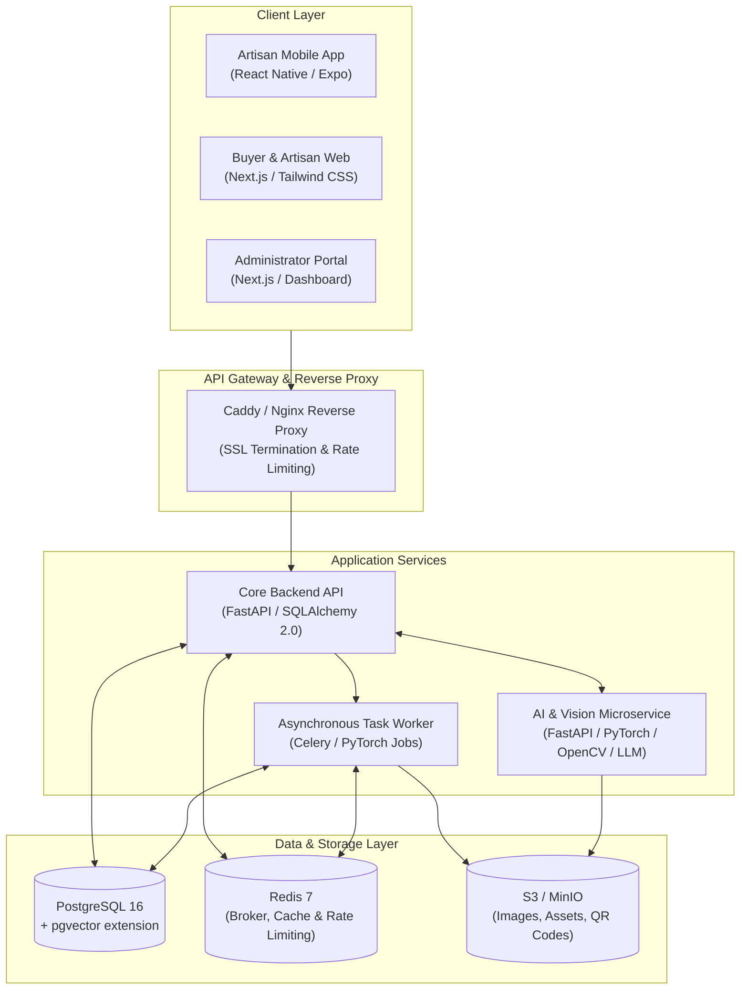

# CraftLens 2.0 System Architecture Specification

## 1. Executive Summary & Vision
CraftLens is an AI-powered artisan business manager and global marketplace platform designed specifically for marginalized artisans, traditional craftspeople, weavers, and self-help groups (SHGs). 

The platform bridges the digital divide through:
- **Zero-Friction Smart Cataloging**: Turning smartphone snapshots into studio-grade e-commerce listings with automated background removal, lighting enhancement, and AI-driven lifestyle staging.
- **Multilingual Voice-First Interface**: Empowering artisans speaking Tamil, Hindi, Telugu, Kannada, Malayalam, and English to dictate product details and receive professional, SEO-optimized listings in both native and international languages.
- **Explainable Dynamic Pricing**: Preventing financial exploitation by calculating realistic production costs, living wages, and tiered wholesale/retail/premium pricing suggestions.
- **Heritage & Provenance Identity**: Embedding cryptographically verifiable craft heritage, regional provenance, and GI-tag validation via tamper-evident QR codes.
- **Omnichannel Marketplace**: Seamlessly separating retail consumer discovery, B2B bulk procurement/RFQ negotiations, and administrator quality governance.

---

## 2. High-Level System Architecture



---

## 3. Monorepo Organization

```
CraftLens/
├── backend/                     # FastAPI core backend service
│   ├── app/
│   │   ├── api/v1/endpoints/    # REST endpoints (auth, products, orders, pricing, etc.)
│   │   ├── core/                # Config, security (Argon2id, JWT), database session
│   │   ├── db/                  # Session management, seed script
│   │   ├── models/              # Normalized SQLAlchemy 2.0 models (38+ tables)
│   │   ├── schemas/             # Pydantic v2 validation schemas
│   │   ├── services/            # Business logic layer
│   │   └── main.py              # Application entrypoint
│   ├── tests/                   # Pytest automated test suites
│   ├── requirements.txt         # Production backend dependencies
│   └── Dockerfile
├── ai-service/                  # AI & Vision microservice
│   ├── app/
│   │   ├── services/            # Vision (rembg, enhancement), Voice, Pricing, NLP
│   │   └── main.py
│   ├── requirements.txt
│   └── Dockerfile
├── buyer-web/                   # Next.js 14 Web Marketplace & Artisan Portal
│   ├── src/                     # App router, components, hooks
│   └── tailwind.config.ts
├── admin-web/                   # Next.js 14 Admin & Analytics Portal
│   ├── src/
│   └── tailwind.config.ts
├── mobile/                      # React Native Expo mobile application
│   ├── app/                     # Expo Router file-based screens
│   └── src/                     # Stores (Zustand), offline SQLite sync
├── docs/                        # Architecture, Database, Design System specs
├── docker-compose.yml           # Unified multi-container deployment
└── .env.example                 # Comprehensive environment variable template
```

---

## 4. Key Architectural Subsystems

### 4.1 Authentication & Role-Based Access Control (RBAC)
- **Roles**: `ARTISAN`, `RETAIL_BUYER`, `WHOLESALE_BUYER`, `ADMIN`.
- **Security Primitives**:
  - Passwords hashed using **Argon2id** (memory-hard, resistant to GPU attacks).
  - Stateless Access Tokens (JWT, 30-minute expiry) with Refresh Token rotation (7-day expiry).
  - Explicit role checks and resource ownership verification on all state-mutating endpoints.

### 4.2 AI Image & Vision Pipeline (Module 1)
```
Raw Artisan Image 
  → Quality & Blur Detection (Laplacian variance)
  → Lighting Enhancement (Gamma/Adaptive CLAHE & Zero-DCE)
  → Subject Segmentation & Background Removal (U²-Net / rembg)
  → Color Balance & Shadow Simulation
  → Lifestyle Canvas Compositing / Crisp Studio White
  → Super-Resolution Upscaling (Real-ESRGAN fallback)
  → WebP & Thumbnail Generation → S3 Upload
```

### 4.3 Multilingual Voice & Natural Language Processing (Module 2)
- Audio capture in Indic regional languages (Tamil, Hindi, Telugu, Kannada, Malayalam, English).
- Pluggable ASR Adapter (Bhashini API / OpenAI Whisper).
- Pluggable Translation Adapter (IndicTrans2 / Bhashini / Gemini 1.5/2.0 Flash).
- Prompt-engineered LLM pipeline extracting structured craft attributes (materials, technique, dimensions, estimated effort) while strictly forbidding fabricated provenance claims.

### 4.4 Explainable Pricing Engine (Module 3)
- **Transparent Formula**:
  $$\text{Base Cost} = \text{Raw Materials} + (\text{Labor Hours} \times \text{Fair Hourly Wage}) + \text{Packaging} + \text{Logistics} + \text{Overheads}$$
  $$\text{Wholesale Price} = \text{Base Cost} \times (1 + \text{Wholesale Margin})$$
  $$\text{Retail Price} = \text{Base Cost} \times (1 + \text{Retail Margin})$$
  $$\text{Premium / Export Price} = \text{Retail Price} \times (1 + \text{Heritage / Rarity Factor})$$
- Gradient boosted regression (LightGBM) calibrates against verified historical transactional data where market comparables exist, providing confidence scores.

### 4.5 Offline-First Artisan Mobile Sync (Module 13)
- Local SQLite database caches drafts, product metadata, and offline audio recordings.
- Background sync queue automatically retries idempotent HTTP POST/PUT requests when network reconnects.
- Optimistic UI updates with visual sync status indicators (`synced`, `syncing`, `draft_local`, `conflict`).
