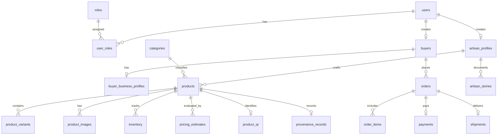

# CraftLens 2.0 Database Schema Specification

## 1. Relational Entity Overview
The CraftLens relational schema is designed for PostgreSQL 16+ using UUIDv4 primary keys, strict Foreign Key referential integrity, check constraints, and `NUMERIC(12, 2)` monetary precision.

---

## 2. Table Catalog (38+ Core Entities)

### A. Identity, Roles & Permissions
1. **`users`**: UUID pk, email, phone, hashed_password (Argon2id), full_name, preferred_language (default 'ta'), is_active, is_verified, created_at, updated_at.
2. **`roles`**: UUID pk, code (`ARTISAN`, `RETAIL_BUYER`, `WHOLESALE_BUYER`, `ADMIN`), name, description.
3. **`permissions`**: UUID pk, code, description.
4. **`role_permissions`**: role_id, permission_id association.
5. **`user_roles`**: user_id, role_id association.
6. **`audit_logs`**: UUID pk, user_id, action, resource, ip_address, user_agent, details (JSONB), created_at.
7. **`consent_records`**: UUID pk, user_id, consent_type, granted, ip_address, recorded_at.

### B. Artisan & Buyer Profiles
8. **`artisan_groups`**: Self-help groups (SHG), cooperatives, weaver clusters.
9. **`artisan_profiles`**: user_id fk, craft_specialization, bio, experience_years, studio_address, city, state, pincode, group_id fk, verified_level, profile_image_url.
10. **`artisan_verifications`**: artisan_profile_id fk, document_type, document_number, document_url, status (`PENDING`, `APPROVED`, `REJECTED`), reviewer_notes, verified_at.
11. **`buyers`**: user_id fk, buyer_type (`RETAIL`, `WHOLESALE`), default_shipping_address, default_billing_address.
12. **`buyer_business_profiles`**: buyer_id fk, company_name, gst_number, pan_number, trade_license_url, verified_status, credit_limit.

### C. Catalog, Categories & Products
13. **`categories`**: UUID pk, name, slug, description, image_url, parent_id fk, sort_order.
14. **`craft_origins`**: UUID pk, name, state, geographical_indication_code, history_notes.
15. **`products`**: UUID pk, artisan_id fk, category_id fk, craft_origin_id fk, title, slug, summary, primary_material, technique, dimensions, weight_grams, status (`DRAFT`, `PENDING_REVIEW`, `ACTIVE`, `ARCHIVED`), view_count.
16. **`product_variants`**: UUID pk, product_id fk, sku, title, color, size, price_retail, price_wholesale, min_wholesale_qty, stock_quantity.
17. **`product_images`**: UUID pk, product_id fk, raw_url, processed_url, background_type (`WHITE`, `LIFESTYLE`, `ORIGINAL`), is_primary, sort_order, quality_score.
18. **`product_translations`**: UUID pk, product_id fk, language_code (`ta`, `hi`, `en`, `te`, `kn`, `ml`), translated_title, translated_description, seo_keywords.
19. **`generated_descriptions`**: UUID pk, product_id fk, source_language, raw_speech_transcript, generated_en, generated_hi, detected_tags (JSONB).

### D. AI & Image Processing Jobs
20. **`image_processing_jobs`**: UUID pk, user_id fk, original_image_url, processed_image_url, operation (`BG_REMOVAL`, `LIGHTING_ENHANCE`, `UPSCALING`, `LIFESTYLE_GEN`), status (`QUEUED`, `PROCESSING`, `COMPLETED`, `FAILED`), error_message, latency_ms.
21. **`ai_jobs`**: UUID pk, user_id fk, job_type (`VOICE_CATALOG`, `PRICING_CALC`, `MARKETING_COPY`, `DEMAND_PREDICT`), status, payload (JSONB), result (JSONB).

### E. Pricing Engine & Cost Accounting
22. **`cost_components`**: UUID pk, product_id fk, material_cost, labor_hours, labor_hourly_rate, packaging_cost, transportation_cost, overhead_cost, total_production_cost.
23. **`pricing_estimates`**: UUID pk, product_id fk, cost_component_id fk, min_selling_price, recommended_retail_price, recommended_wholesale_price, premium_export_price, profit_margin_percent, confidence_score, explanation_text.
24. **`pricing_history`**: UUID pk, product_id fk, changed_by fk, old_price, new_price, reason, changed_at.
25. **`market_comparables`**: UUID pk, category_id fk, source_platform, sample_title, price_range_min, price_range_max, recorded_date.

### F. Inventory, Orders & Commerce
26. **`inventory`**: UUID pk, product_variant_id fk, quantity_on_hand, reserved_quantity, low_stock_threshold.
27. **`stock_movements`**: UUID pk, inventory_id fk, quantity_change, movement_type (`PURCHASE_RECEIPT`, `SALE_DEDUCT`, `RETURN_RESTOCK`, `MANUAL_ADJUST`), reference_id, notes.
28. **`orders`**: UUID pk, order_number, buyer_id fk, order_type (`RETAIL`, `WHOLESALE`), subtotal, discount, tax, shipping_fee, total_amount, status (`PENDING`, `CONFIRMED`, `SHIPPED`, `DELIVERED`, `CANCELLED`), delivery_address (JSONB).
29. **`order_items`**: UUID pk, order_id fk, product_variant_id fk, artisan_id fk, quantity, unit_price, total_price.
30. **`payments`**: UUID pk, order_id fk, payment_gateway (`RAZORPAY`, `ONDC`, `CASH_ON_DELIVERY`), transaction_ref, amount, currency, status (`INITIATED`, `SUCCESS`, `FAILED`, `REFUNDED`), paid_at.
31. **`shipments`**: UUID pk, order_id fk, carrier, tracking_number, status (`MANIFESTED`, `IN_TRANSIT`, `OUT_FOR_DELIVERY`, `DELIVERED`), shipped_at, delivered_at.

### G. B2B Wholesale & RFQ
32. **`purchase_requests`**: UUID pk, buyer_id fk, product_id fk, target_quantity, target_unit_price, required_delivery_date, specifications, status (`OPEN`, `RESPONDED`, `ACCEPTED`, `REJECTED`).
33. **`quotations`**: UUID pk, purchase_request_id fk, artisan_id fk, quoted_unit_price, total_amount, lead_time_days, terms_conditions, status (`PENDING`, `ACCEPTED`, `REJECTED`, `EXPIRED`).
34. **`purchase_orders`**: UUID pk, quotation_id fk, po_number, payment_terms, milestone_schedule (JSONB), status (`DRAFT`, `ISSUED`, `IN_PRODUCTION`, `FULFILLED`).

### H. Heritage, Provenance & Storytelling
35. **`artisan_stories`**: UUID pk, artisan_profile_id fk, title, story_body, audio_clip_url, video_clip_url, is_heritage_approved.
36. **`provenance_records`**: UUID pk, product_id fk, batch_code, raw_materials_source, craft_technique_details, maker_signature_hash, timestamp.
37. **`product_qr`**: UUID pk, product_id fk, qr_code_hash, public_url, scan_count, last_scanned_at.

### I. Operations, Analytics & Marketing
38. **`reviews`**: UUID pk, product_id fk, order_item_id fk, buyer_id fk, rating (1-5), comment, is_verified_purchase.
39. **`notifications`**: UUID pk, user_id fk, title, message, channel (`IN_APP`, `SMS`, `WHATSAPP`), read_status, created_at.
40. **`marketing_campaigns`**: UUID pk, artisan_id fk, campaign_name, platform (`INSTAGRAM`, `WHATSAPP`, `FESTIVAL_CATALOG`), status.
41. **`marketing_assets`**: UUID pk, campaign_id fk, asset_type (`POSTER`, `CAPTION`, `STORY_BANNER`), content_text, media_url.
42. **`business_expenses`**: UUID pk, artisan_id fk, expense_date, category (`MATERIALS`, `TOOLS`, `LOGISTICS`, `UTILITIES`), amount, notes.
43. **`demand_predictions`**: UUID pk, category_id fk, region, predicted_growth_rate, confidence_interval, period_start, period_end.
