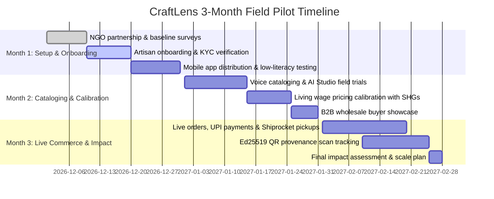

# CraftLens 2.0 – 3-Month Field Pilot Implementation Plan

This document details the on-ground implementation plan for conducting a controlled 3-month field pilot of CraftLens across two representative Indian artisan clusters.

---

## 1. Pilot Cluster Selection

| Cluster | Location | Primary Craft Specialization | Cluster Size | Selected Cohort | Local Language |
|---|---|---|---|---|---|
| **Cluster A: Varanasi Weavers** | Lohta & Kotwa, Varanasi, Uttar Pradesh | Handwoven Banarasi Silk Sarees & Brocade Dupattas (GI-002) | ~8,000 pit looms | **35 Master Weavers** | Hindi / Bhojpuri |
| **Cluster B: Vilachery Potters** | Vilachery, Madurai, Tamil Nadu | Terracotta Sculptures, Golu Dolls & Hand-Painted Clayware | ~180 artisan families | **25 Artisan Families** | Tamil |

---

## 2. On-Ground NGO & Verification Partners

To maintain trust and prevent fraudulent registrations, CraftLens partners with established local craft organizations:
1. **Cluster A (Varanasi)**: Partnering with **Human Welfare Association (HWA)**, a registered Varanasi NGO actively supporting handloom weaver Self-Help Groups (SHGs) and GI registration compliance.
2. **Cluster B (Vilachery)**: Partnering with the **Vilachery Terracotta Artisans Cooperative Society**, which maintains official rosters of registered traditional artisans.

### Partner Responsibilities
- Verifying physical Artisan Pehchan identity cards issued by the Ministry of Textiles.
- Validating raw material sourcing and authenticity of Geographical Indication claims.
- Facilitating weekly physical check-ins and collecting qualitative UX feedback.

---

## 3. Phased 3-Month Rollout Timeline

### Month 1: Infrastructure, KYC, and Baseline Setup
- **Baseline Economic Survey**: Record baseline metrics per artisan: current monthly net income, average selling price per item to local traders, and average time spent listing products online.
- **Hardware & Connectivity Setup**: Test mobile app on entry-level Android devices (2GB RAM, Android 10+, Redmi / Realme) on 3G/4G rural networks.
- **Artisan Identity Verification**: Ingest and verify Pehchan cards and bank passbooks via `admin-web` KYC moderation queue.

### Month 2: Voice Cataloging, AI Studio, & Pricing Calibration
- **Voice Assistant Testing**: Conduct workshop sessions where weavers speak in colloquial dialects (Bhojpuri and Madurai Tamil) to test speech recognition confidence and entity extraction.
- **Pricing Calibration**: Benchmark living-wage calculations against local wage boards and raw material costs (e.g., pure zari vs. tested zari pricing).
- **Offline Draft Testing**: Intentionally simulate field disconnects to verify `expo-sqlite` draft persistence and background reconnection sync.

### Month 3: Live Pilot Commerce & Provenance Tracking
- **Pilot Catalog Launch**: Publish ~150 certified artisan products on `buyer-web`.
- **Order Fulfillment & Logistics**: Test doorstep pickup in Lohta and Vilachery via Shiprocket local hub integrations.
- **Packaging & Provenance**: Affix CraftLens Ed25519 QR verification stickers to physical packaging. Track buyer scan rates and authenticity confirmations.
- **Settlement & Dispute Handling**: Reconcile payouts to artisan bank accounts within 48 hours of order delivery.

---

## 4. Key Performance Indicators (KPIs) & Success Targets

| Metric | Baseline (Middleman / Traditional) | CraftLens Pilot Target | Measurement Method |
|---|---|---|---|
| **Cataloging Time per Product** | 25 – 45 minutes | **< 3 minutes** | App session duration tracking from camera capture to confirmation |
| **Voice Interaction Success Rate** | 0% (text only) | **>= 80%** | Successful transcription and extraction without typing |
| **Artisan Net Margin Increase** | 15% – 25% | **>= 40%** | Post-pilot income audit vs. baseline survey |
| **Buyer Provenance Verification Rate**| 0% (no verification) | **>= 35% of orders** | Scans recorded on `/heritage/verify/{qr_hash}` |
| **Offline Sync Reliability** | Data loss common | **100% zero data loss** | Conflict log and SQLite sync audit trail |
| **Order Dispute & Return Rate** | 8% – 12% | **< 3%** | Backend order state machine statistics |

---

## 5. Risk Mitigation & Governance

- **Low Digital Literacy**: The mobile app employs an icon-first design with audio prompts in Tamil and Hindi. No written typing is required for core product cataloging.
- **Poor Rural Connectivity**: All product drafts, photo captures, and price calculations operate offline via SQLite. Background sync resumes automatically upon reconnecting to network.
- **Counterfeit Protection**: Each artisan's physical output is sealed with a tamper-evident QR code linked to an immutable Ed25519 digital signature. Counterfeits cannot forge the signature of the CraftLens Root Authority.

